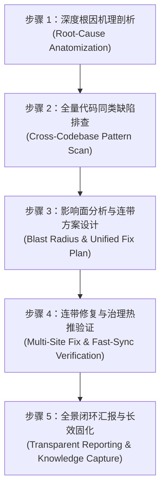

# ERPNext 16 Bug 全量排查与连带根除操作流程 (Universal Bug Pattern Scan & Elimination Standard)

本技能定义了在本工程中排查、治理和根除任何系统缺陷的标准工作流。
**最高治理准则：任何 Bug 严禁孤立单点修补，必须顺藤摸瓜、全量排查、连根拔起、彻底根除！**

---

## 🧭 核心执行五步法 (The 5-Step Elimination Lifecycle)



---

### 步骤 1：深度根因机理剖析 (Deep Root-Cause Anatomization)

当用户提出一个 Bug 或发现一处缺陷时，绝对禁止停留在“表面现象”。必须探究底层产生机理：
1. **数据模型与粒度断层**：
   - 是否存在「单头聚合（Doc Header）」与「明细行（Item Rows）」的数据结构脱节？
   - 字段是否仅存在于明细而不存在于单头？反之亦然？
2. **状态与视图分化**：
   - 「单号视图（Doc View）」与「明细视图（Detail View）」在数据拉取、选中状态缓存、参数传递上是否对等？
3. **前后端接口契约脱节**：
   - 前端是否传了参数但后端 SQL 没有过滤？后端是否支持数组/批量（如 `po_names` vs `po_name`）？
4. **生命周期与状态机违约**：
   - 单据在 Draft (0)、Submitted (1)、Cancelled (2) 下是否有逻辑空洞？
   - 是否存在缺少前置校验、忽略权限或重复提交的隐患？

---

### 步骤 2：全量代码同类缺陷排查 (Universal Cross-Codebase Pattern Scan)

提取该 Bug 的**抽象特征模式（Abstract Pattern）**，在全仓库展开地毯式检索。排查清单包括但不限于：

1. **同流程相邻阶段 (Adjacent Workflow Stages)**：
   - 采购流程全链路核查：
     - `mr_to_po`（物料申请转订单）
     - `po_to_pr`（订单转收货单）
     - `pr_to_pi`（收货单转采购发票）
     - `pi_to_rr`（发票转采购整算）
     - `pi_to_pay`（发票转对公付款）
2. **同类工作台与选单台 (Symmetrical Workbenches & Pickers)**：
   - `procurement_workbench.js`（采购全链路工作台）
   - `stock_issue_workbench.js`（领料出库工作台）
   - `wire_transfer_picker.js`（自办电汇对账台）
   - `monthly_settlement_picker.js`（月结入库工作台）
   - `reimbursement_picker.js`（报销管理中心）
   - 各自定义 HR 薪酬工作台（祺富 vs 吉众）
3. **后端对应查询与操作 API (Symmetrical Backend Services)**：
   - `get_pending_*_items` / `get_pending_*_docs`
   - `get_all_*_items` / `get_all_*_docs`
   - `make_*_from_*_items` 批量生成服务
4. **生成影响面矩阵表 (Blast Radius Matrix)**：
   在分析中显式绘制排查矩阵，标记每一处状态：
   - `[DEFECT]`：存在同类严重缺陷，必须同时连带修复；
   - `[RISK]`：存在潜在边界风险，需加固；
   - `[SAFE]`：已正确实现，作为标准对照样板。

---

### 步骤 3：影响面分析与连带方案设计 (Blast Radius & Unified Fix Plan)

设计一揽子对称化修复方案，确保代码风格与处理逻辑在全仓库达成 100% 一致性：
1. **后端 API 对称性规范**：
   - 所有支持按单号过滤的 API，必须同时支持单数 `x_name`（模糊搜索）与复数 `x_names`（列表精确匹配 `IN %(x_names)s`）；
   - 参数解析必须容错支持 JSON 数组字符串或英文逗号分隔字符串；
2. **前端弹窗与选单规范**：
   - 当在「单号视图」勾选单据生成下游依赖明细的单据（如收货单、采购发票）时，前端弹窗处理函数必须声明为 `async`；
   - 必须先检测勾选项是否缺失明细字段（如 `!it.item_code`），若缺失则自动异步拉取后端展开明细接口；
   - 弹窗内必须 100% 完整填充物料代码、规格型号、单位、数量、单价 `rate`、税率及含税总金额，杜绝金额为 0 现象。

---

### 步骤 4：连带修复与治理热推验证 (Multi-Site Fix & Fast-Sync Verification)

1. **协同修改**：将所有存在同类缺陷的组件前后端代码一次性连带修改；
2. **运行 AI 架构治理脚本**：
   ```bash
   python scripts/verify_ai_architecture_governance.py
   ```
   必须通过：`PASS: 0 blocking violations, 0 warning(s)`。
3. **运行 UI Style Kit 规范检查**：
   ```bash
   python scripts/verify_ui_style_governance.py
   ```
   必须通过：不引入任何非法的 inline style。
4. **极速热同步部署**：
   ```bash
   python scripts/fast_sync.py
   ```
   使用增量流式管道直写容器，实现 <1 秒无感生效，容器保持热机。

---

### 步骤 5：全景闭环汇报标准 (Transparent Reporting Standards)

在向用户答复时，严禁轻描淡写，必须以专业透明的结构汇报完整闭环：
1. **原发缺陷机理分析**：说明该 Bug 发生的根本技术原因与业务背景；
2. **全量排查范围清单**：列出全仓库检索的所有阶段与模块，并附带排查矩阵；
3. **连带发现与连根拔起**：明确指出本次顺带发现了哪些隐藏的同类隐患，并已全部连带修复；
4. **治理与验证证据**：附带架构治理通过的检查结果与 Fast-Sync 同步日志；
5. **用户验证指引**：指导用户刷新浏览器或进行关键场景验收。
